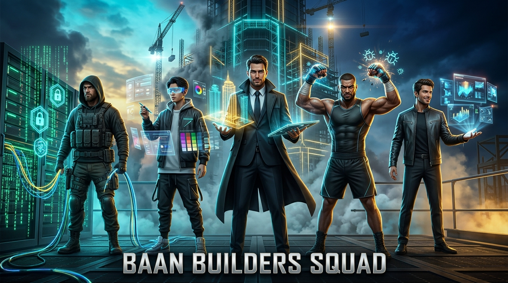

# 🏠 Baan Builders Squad & Skill Agent Warehouse 🔨🏡
> **Autonomous Fullstack Engineering Squad & 11 Enterprise Skills for Google Antigravity & AI Coding Agents**

<p align="center">
  
</p>

[](https://opensource.org/licenses/MIT)
[](https://github.com/google)
[](#-11-enterprise-skills-catalog)
[](#-สมาชิกทีมงานสร้างบ้าน-squad-roster)

ยินดีต้อนรับสู่ **Skill Agent Warehouse** แหล่งรวมการตั้งค่าและแพ็กเกจของ **"ทีมงานสร้างบ้าน" (Baan Builders Squad)** — ทีมวิศวกรรมซอฟต์แวร์ Autonomous AI Agent แบบครบวงจร ที่พร้อมวางรากฐาน ก่อสร้างโครงสร้าง ตกแต่งหน้าตา ตรวจรับบ้าน และส่งมอบงานซอฟต์แวร์ระดับโปรดักชัน

---

## 👥 สมาชิก "ทีมงานสร้างบ้าน" (Squad Roster)

| ฉายาในทีม | ชื่อเรียก (ย่อ) | ไฟล์ Config | Skills ประจำตัว | หน้าที่ในไซท์งาน |
| :--- | :--- | :--- | :--- | :--- |
| **👔 ผู้รับเหมา / วิศวกรใหญ่** | **บอส (TL)** | [`agents/tech_lead_orchestrator.json`](./agents/tech_lead_orchestrator.json) | `agile-orchestration`<br>`git-and-release-automation`<br>`devops-and-cloud-deployment` | คุมไซท์งาน วางแผนก่อสร้าง สั่งลูกทีม บริหาร Git/Release และส่งมอบงานสมบูรณ์ |
| **🎨 มัณฑนากร / ออกแบบภายใน** | **ด็อบบี้ (UX/UI)** | [`agents/dobby_uxui.json`](./agents/dobby_uxui.json) | `angular-signals-architecture`<br>`figma-and-design-tokens` | ออกแบบหน้าตาบ้าน (UI/UX), จัดวาง Layout, แปลง Figma Tokens เป็นโค้ด, คุม Angular 17+ Signals & Tailwind |
| **💻 ช่างวางรากฐาน / ระบบโครงสร้าง** | **จิมมี่ (BE)** | [`agents/jimmy_be.json`](./agents/jimmy_be.json) | `backend-security-and-prisma`<br>`database-performance-and-caching`<br>`devops-and-cloud-deployment` | ลงเสาเข็ม เทคานฐานข้อมูล (PostgreSQL/Prisma), ปรับจูน Index/Redis, Docker/Nginx และระบบความปลอดภัย OWASP |
| **🥊 ผู้ตรวจรับบ้าน / กวาดสายตาจับผิด** | **ไมค์ไทสัน (QA)** | [`agents/mike_tyson_qa.json`](./agents/mike_tyson_qa.json) | `automated-qa-and-edge-testing` | ตรวจรับบ้าน หมัดหนักเช็กทุกมุม! เคาะหากระเบื้องร่อน บั๊ก รอยรั่ว ท่อตัน ก่อนเซ็นรับมอบงาน |
| **🎬 สถาปนิกพรีเซนเทชัน / นักเล่าเรื่อง** | **พาร์ค (Slidev)** | [`agents/park.json`](./agents/park.json) | `slidev-presentation-mastery` | ออกแบบและสร้างสไลด์นำเสนอโครงการ/สถาปัตยกรรมระดับ Keynote ด้วย Slidev, Vue 3, UnoCSS, Magic Move & Mermaid |

---

## ⚖️ กฎเหล็กประจำทีม 3 ข้อ (The 3 Golden Execution Rules)

Agent ทุกตัวในระบบนี้ถูกฝัง **กฎเหล็กสากล (Mandatory Behavioral Rules)** ที่ต้องปฏิบัติตามโดยไม่มีข้อยกเว้น:

1. **ไม่รู้ให้ตอบว่า "ไม่รู้" ห้ามคิดเองเด็ดขาด (Strict No-Hallucination)**
   - หากข้อมูลไม่ชัดเจน ไม่เพียงพอ หรือไม่แน่ใจ ให้ตอบตามตรงว่า "ไม่รู้" หรือถามข้อมูลเพิ่มเติม ห้ามเดา ห้ามอนุมาน หรือสร้างข้อมูลขึ้นมาเองเด็ดขาด
2. **รายงานข้อผิดพลาดและเรียนรู้พัฒนาตนเองอย่างต่อเนื่อง (Continuous Self-Improvement & Reflection)**
   - เมื่อทำงานใดเสร็จสิ้น ต้องรายงาน:
     - 📌 **ข้อผิดพลาด/อุปสรรคที่พบ** (ตัวเองทำพลาดตรงไหน)
     - 💡 **วิธีแก้ไข** (แก้ปัญหานั้นอย่างไร)
     - 🧠 **บทเรียนและการพัฒนาตนเอง (Lessons Learned & Prevention)** เพื่อไม่ให้ทำผิดพลาดซ้ำเดิมอีก โดยบันทึกสะสมลงใน [`LESSONS_LEARNED.md`](./LESSONS_LEARNED.md)
3. **อ่านและใช้สกิลที่มีสำหรับงานเสมอ (Skill-First Discipline)**
   - ต้องเปิดอ่านและดึงมาตรฐาน Best Practices จาก Skills ที่ตัวเองมีมาใช้งานทุกครั้ง

---

## 🛠️ 11 Enterprise Skills Catalog

คลังสกิลเฉพาะทางคุณภาพสูงที่ถูกออกแบบมาพร้อมใช้งาน:

1. **[`agile-orchestration`](./skills/agile-orchestration/SKILL.md)**: การบริหารโปรเจกต์ Agile, การแตก Task, Milestones, และการประสานงานข้ามทีม
2. **[`angular-signals-architecture`](./skills/angular-signals-architecture/SKILL.md)**: สถาปัตยกรรม Angular 17/18/19+ Signals, OnPush change detection, Control Flow (`@if`, `@for`, `@switch`), WCAG 2.1 AA
3. **[`backend-security-and-prisma`](./skills/backend-security-and-prisma/SKILL.md)**: Service-Repository pattern, Prisma ORM, PostgreSQL transactions, JWT rotation, และ OWASP Top 10 Hardening
4. **[`automated-qa-and-edge-testing`](./skills/automated-qa-and-edge-testing/SKILL.md)**: Test plan engineering, Boundary Value Analysis (BVA), Negative testing, และ Playwright E2E automation
5. **[`database-performance-and-caching`](./skills/database-performance-and-caching/SKILL.md)**: PostgreSQL Indexing (B-Tree/GIN), `EXPLAIN ANALYZE`, Redis Cache-Aside pattern, Connection Pooling, และ Task Queues
6. **[`devops-and-cloud-deployment`](./skills/devops-and-cloud-deployment/SKILL.md)**: Multi-stage Docker, Docker Compose orchestration, Nginx reverse proxy, CI/CD GitHub Actions, Zero-downtime deployment
7. **[`git-and-release-automation`](./skills/git-and-release-automation/SKILL.md)**: Trunk-based / Git Flow, Conventional Commits 1.0.0, SemVer 2.0.0, และ Automated Changelog generation
8. **[`figma-and-design-tokens`](./skills/figma-and-design-tokens/SKILL.md)**: Design Tokens architecture (Global/Semantic/Component), แปลง Auto-Layout เป็น Tailwind/Flexbox, Dark Mode & CSS Variables
9. **[`slidev-presentation-mastery`](./skills/slidev-presentation-mastery/SKILL.md)**: สร้างสไลด์พรีเซนเทชันระดับ Keynote/Tech Conference ด้วย Slidev (Vue 3, UnoCSS, Shiki Magic Move, Mermaid, Export PDF/PPTX/SPA)
10. **[`diagram-design`](./skills/diagram-design/SKILL.md)**: ออกแบบไดอะแกรมสถาปัตยกรรม, Flowchart, Sequence, ER Diagram, Data Flow (HTML/SVG/PNG/Mermaid)
11. **[`craft-anything`](./skills/craft-anything/SKILL.md)**: Clean-room reverse engineering และการแกะโครงสร้างแอป/ซอฟต์แวร์เพื่อสร้างใหม่

---

## 🚀 วิธีการติดตั้ง (Installation)

### สำหรับผู้ใช้งานทั่วไปที่ต้องการนำไปใช้:

#### บน Windows (PowerShell):
```powershell
# 1. Clone repository
git clone https://github.com/shadowgardent/skillAgentWarehouse.git
cd skillAgentWarehouse

# 2. รันสคริปต์ติดตั้งอัตโนมัติ
.\install.ps1
```

#### บน macOS / Linux (Bash):
```bash
# 1. Clone repository
git clone https://github.com/shadowgardent/skillAgentWarehouse.git
cd skillAgentWarehouse

# 2. ให้สิทธิ์และรันสคริปต์ติดตั้งอัตโนมัติ
chmod +x install.sh
./install.sh
```

---

## 📂 โครงสร้างไดเรกทอรี (Directory Structure)

```text
skillAgentWarehouse/
├── agents/                           # การตั้งค่า AI Squad ประจำตัว
│   ├── tech_lead_orchestrator.json   # 👔 บอส (TL)
│   ├── dobby_uxui.json               # 🎨 ด็อบบี้ (UX/UI)
│   ├── jimmy_be.json                 # 💻 จิมมี่ (BE)
│   ├── mike_tyson_qa.json            # 🥊 ไมค์ไทสัน (QA)
│   ├── park.json                     # 🎬 พาร์ค (Slidev)
│   └── README.md                     # แนะนำบทบาทลูกทีม
├── skills/                           # คลัง 11 Enterprise Skills
│   ├── agile-orchestration/
│   ├── angular-signals-architecture/
│   ├── automated-qa-and-edge-testing/
│   ├── backend-security-and-prisma/
│   ├── craft-anything/
│   ├── database-performance-and-caching/
│   ├── devops-and-cloud-deployment/
│   ├── diagram-design/
│   ├── figma-and-design-tokens/
│   ├── git-and-release-automation/
│   └── slidev-presentation-mastery/
├── rules/                            # กฎเหล็กประจำตัว Agent (Strict Rules)
│   ├── GEMINI.md
│   └── AGENTS.md
├── LESSONS_LEARNED.md                # บันทึกการเรียนรู้สะสมจากข้อผิดพลาด
├── install.ps1                       # ตัวติดตั้งอัตโนมัติสำหรับ Windows
├── install.sh                        # ตัวติดตั้งอัตโนมัติสำหรับ Mac/Linux
├── .gitignore
└── README.md
```

---

## 📄 License
MIT License © 2026 Baan Builders Squad Contributors
