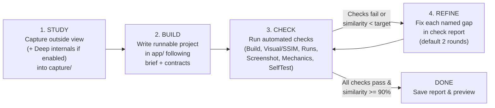

# Craft Anything — Complete Investigation, Rebuild & Architecture Skill

Craft Anything gives an agent **314+ structured tools** (299 engine tools across 17 toolsets + AI/Rebuild/Setup tools) for studying existing software, websites, apps, games, binaries, packages, and protocols—and rebuilding or remixing them from evidence via the **Study → Build → Check → Refine** workflow.

Every tool call that inspects something records **evidence (`ev_...`)** in the project workspace with content hashes (`sha256`), byte ranges, addresses, and tool provenance so every claim can be cited and checked.

---

## Quick Navigation (Reference Library)

Load these reference files on demand depending on your task:

1. **[`references/recovery.md`](references/recovery.md)** — **Setup, Doctor, Recovery & External Engines**: When MCP tools are missing, CLI fallback, client config locations (Claude Code, Codex, Cursor, Windsurf, Zed, OpenCode, Gemini CLI, GitHub Copilot, Kiro, Continue, Antigravity), and all 18 external engines (Ghidra, ADB, JADX, Apktool, Chromium, Frida, GDB, LLDB, mitmdump, Binwalk, Unblob, ILSpy, Java, tshark, objdump, Rizin, rtl_433, Vineflower).
2. **[`references/tools-catalog.md`](references/tools-catalog.md)** — **All 314+ Tools, Naming Rules & Clean-Room Allowlist**: Complete table of all 299 engine tools across 17 toolsets (`core`, `native`, `apple`, `formats`, `managed`, `android`, `java`, `adb`, `browser`, `javascript`, `runtime`, `frida`, `application`, `database`, `projects`, `setup`, `build`), AI/Rebuild/Setup tools, `<area>_<object>_<action>` naming law, and the 95-tool Clean-Room allowlist.
3. **[`references/rebuild-workflow-and-prompts.md`](references/rebuild-workflow-and-prompts.md)** — **The Complete Rebuild System (`Study → Build → Check → Refine`)**: Exact Builder/Study/Extractor prompts, contracts (`RULES`, `WEBSITE_FROM_OUTSIDE`, `PROGRAM_FROM_OUTSIDE`, `DECOMPILE_FIRST`, `MECHANICS_CONTRACT`, `SCREENSHOT_CONTRACT`, `SELF_TEST_CONTRACT`, `PRIVATE_USE_NOTE`, `RUNS_BRIEF`, `API_BUILDER`), target kinds (`WebsiteKind`, `AppKind`, `GameKind`), stacks (`stacks.toml`), and automated verification checks (`WebVisualCheck`, `BuildCheck`, `RunsCheck`, `ScreenshotCheck`, `MechanicsCheck`, `SelfTestCheck`, `CreditsCheck`, `PluginCheck`).
4. **[`references/investigation-and-mcp-prompts.md`](references/investigation-and-mcp-prompts.md)** — **Investigator System Prompts & 6 Guided MCP Prompts**: Full `METHOD`, `BEGINNER`, and `EXPERIENCED` investigator prompts, working memory discipline, and the 6 MCP prompt templates (`core_feature_explain`, `app_graphs_compare`, `app_rebuild_claim_check`, `native_crash_explain`, `core_unknowns_review`, `runtime_run_plan`).
5. **[`references/architecture-and-extending.md`](references/architecture-and-extending.md)** — **7-Layer Crate Architecture, 11 Golden Rules, Plugins & File Formats**: Workspace crate hierarchy (`L0`–`L6`), architectural invariants, extension seams, WASM (`plugin.wit`) & MCP plugins, and versioned file schemas (`craft.json`, `build-progress.json`, `mechanics.json`, `self-test.json`).
6. **[`references/pitfalls-and-lessons.md`](references/pitfalls-and-lessons.md)** — **Hard-Won Engineering Lessons & Agent CLI Adapters**: Every rule from `docs/pitfalls.md` (Git, Tests, Building/Running, Design, Agent Tooling) and adapter quirks for Claude Code, Codex, OpenCode, and Antigravity (`agy`).
7. **Resources & Schemas (`resources/`)**:
   - [`resources/stacks.toml`](resources/stacks.toml) — Stack & UI library recipes
   - [`resources/assets.toml`](resources/assets.toml) — Game asset generation models & pricing (`fal.ai`: `nano-banana-pro`, `flux-dev`, `flux-schnell`, `tripo-p1`)
   - [`resources/plugin.wit`](resources/plugin.wit) — WIT interface for WASM tool & check plugins
   - [`resources/schemas/craft.schema.json`](resources/schemas/craft.schema.json), [`build-progress.schema.json`](resources/schemas/build-progress.schema.json), [`mechanics.schema.json`](resources/schemas/mechanics.schema.json), [`self-test.schema.json`](resources/schemas/self-test.schema.json)
8. **Example WASM Plugins (`examples/`)**:
   - [`examples/wasm-plugin-wordcount/`](examples/wasm-plugin-wordcount/README.md) — `craft-anything:plugin/tools` example
   - [`examples/wasm-plugin-readme-check/`](examples/wasm-plugin-readme-check/README.md) — `craft-anything:plugin/checks` example

---

## Part 1: Using Craft Anything Tools (Official MCP & CLI Guide)

### How to call tools

Prefer the **`craft-anything` MCP server** when its tools are in your tool list (tool names like `core_target_open`, `native_functions_list`, `web_site_open`). If they are not loaded in this session, run the same tools through `craft-anything-cli call <tool_id> '<json>' --json` — see [`references/recovery.md`](references/recovery.md).

Never guess a tool name or its parameters:

- Call `core_tools_catalog` (or `craft-anything-cli list --json`) to search tools by keyword or toolset.
- Call `core_tool_describe` with `{"id": "<tool_id>"}` (or `craft-anything-cli describe <tool_id> --json`) to get the full JSON Schema before calling an unfamiliar tool.

### Clean-room mode vs Deep mode

Craft Anything starts in **Clean-room mode**: it studies what a program or website shows from the outside (screenshots, computed styles, DOM, accessibility/UI trees, public HTTP responses, running the binary from outside). Tools that read internal code or files are hidden from the tool list and refused if called.

**Deep mode** adds binary disassembly, decompilation, bytecode/DEX/IL/.NET/Java/JS bundle inspection, archives, firmware, and dynamic tracing. It is off unless the user turns it on (`--deep` on the CLI, `settings_set` with `{"key": "deep_mode", "value": true}`, or in the app's Settings) and confirms they have the right to inspect the target's internals. If a tool returns a clean-room refusal, explain what it needs and ask the user rather than working around it.

### First moves by target kind

| Target | First tool calls |
|---|---|
| Local file, binary, app bundle, APK, archive, or directory | `core_target_open` with `{"path": "<absolute path>"}` → `core_target_overview` → `core_file_detect` |
| Live website | `web_site_open` with `{"url": "https://..."}` → `web_site_capture` (captures desktop, tablet, and phone screenshots, DOM, styles, and landmarks) → `web_page_states_capture` for menus/dialogs/tabs |
| Full website, app, or game rebuild (`Study → Build → Check → Refine`) | `rebuild_start` with `{"target": "<url, path, or ->", "request": "<what to make>"}` (or `craft-anything-cli rebuild <target> "<request>"`) |
| Native binary (ELF, PE, Mach-O) *(Deep mode)* | `core_target_open` → `native_binary_summary` → `native_functions_list` → `native_function_decompile` or `native_cfg_build` |
| Apple `.app` / `.ipa` / universal binary / `.car` *(Deep mode)* | `apple_bundle_inspect` / `apple_universal_inspect` / `apple_codesign_verify` / `apple_plist_read` / `apple_assets_car_inspect` |
| Android APK / AAB / DEX *(Deep mode)* | `android_apk_summary` → `android_manifest_read` → `android_dex_classes` → `android_class_decompile` |
| .NET assembly *(Deep mode)* | `managed_dotnet_summary` → `managed_dotnet_types` → `managed_dotnet_decompile` |
| Java `.class` / `.jar` *(Deep mode)* | `java_jar_inspect` / `java_class_inspect` → `java_class_decompile` |
| JavaScript / Source maps / Webpack / Electron `.asar` *(Deep mode)* | `js_bundle_inspect` / `js_sourcemap_unpack` / `js_strings_extract` / `formats_asar_inspect` |
| Archive, installer, disk image, firmware, PCAP *(Deep mode)* | `formats_container_detect` → `formats_archive_list` or `formats_firmware_scan` or `formats_pcap_summary` |
| SQLite / LevelDB / Realm / Redis / IndexedDB *(Deep mode)* | `db_sqlite_schema` → `db_sqlite_query`, or `db_leveldb_scan` / `db_indexeddb_inspect` |
| Running app or CLI (outside observation) | `runtime_run_observe` / `app_window_capture` / `app_ui_tree_read` / `runtime_http_record` |

### Working memory & evidence discipline

For any multi-step investigation, keep the workspace's working memory current instead of holding conclusions only in chat:

1. **Orient first**: Call `core_investigation_show` at the start to see the current target, brief, plan, open hypotheses, findings, unknowns, and recent evidence.
2. **Write the brief & plan**: Record the goal in `core_brief_write` and the step list in `core_plan_update`.
3. **Predict before testing**: Record testable hypotheses with `core_hypothesis_record` (`proposed` → `testing` → `supported` / `refuted` / `inconclusive` via `core_hypothesis_update`) before running expensive tools.
4. **Cite `ev_...` IDs in every finding**: Every tool result returns an `evidence_id` (`ev_...`). Pass those IDs when calling `core_finding_record`. Never present a guess as a finding:
   - **Observed**: Directly in tool output (`ev_...`).
   - **Derived**: Mechanically computed from observations (cite the source `ev_...`).
   - **Inferred**: An interpretation—label it as a hypothesis, not a fact, until tested.
5. **Absence is not proof**: If symbols are stripped, a network call wasn't triggered, or a code path wasn't reached, record an explicit unknown via `core_unknown_add` (and resolve via `core_unknown_edit`) instead of claiming the feature doesn't exist.
6. **Summary first, then page**: Start with `*_summary` or `*_list` tools with `limit` / `offset`, or page through large evidence items with `core_evidence_browse`, before pulling full decompilations or hex dumps (`core_bytes_read`).
7. **Format-aware, not filename-aware**: Trust `core_file_detect` / `formats_container_detect` over file extensions.
8. **Handoff**: Before finishing a long session, call `core_handoff_write` so the next session can resume cleanly.

### Consent & safety

Tools marked `EXECUTES_FOREIGN_CODE` or `MUTATES_DEVICE` (running a target binary, attaching a debugger or Frida script, installing on a device, editing agent client configs) require explicit consent:
- On the CLI, pass `--allow-run` only when the user has approved executing or mutating the target.
- Over MCP, only pass `"consent": true` inside `"_craft"` after the user has explicitly said yes in the conversation.

---

## Part 2: The Rebuild Workflow (`Study → Build → Check → Refine`)

Whether running via `rebuild_start` / `craft-anything-cli rebuild` or manually executing a rebuild inside an agent session, follow Craft Anything's 4-stage loop:

### Workspace directory layout

Every Craft Anything project workspace (`ws.root`) uses this structure:
- `craft.json` — Versioned project manifest (`format_version: 1`)
- `capture/` — Study outputs (`study.md`, `how-it-works.md`, `desktop.png`, `tablet.png`, `phone.png`, `page.json`, `states.json`, `routes/<slug>/`, `window.png`, `ui-tree.json`, `check-round-<N>/`)
- `reference/` — Reference images or files dropped by the user
- `app/` — **The rebuilt application** (all built code lives here, or directly in `ws.root` if `--existing edit` was used)
- `evidence/` — Content-addressed blobs (`blobs/sha256/<ab>/<hash>`) + `items/ev_*.json`
- `reports/` — Saved reports (`check-round-<N>.md`, `build-progress.json`)

### Target Kind 1: Websites (`WebsiteKind`)

1. **Study (`capture/`)**:
   - Open live site with `web_site_open` and capture with `web_site_capture` (`widths: [1440, 768, 390]`, `noise_pass: true`) to produce `capture/desktop.png`, `capture/tablet.png`, `capture/phone.png`, and `capture/page.json` (computed styles, colours, fonts, spacing, landmarks, text blocks, image boxes, controls).
   - Capture interactive states on desktop (`1440×900`) and phone (`390×844`) with `web_page_states_capture` → `capture/states.json` & `capture/state-*.png` (menus, popups, tabs).
   - Capture up to 12 internal routes (`capture/routes/<slug>/`) discovered from navigation links.
   - In **Deep mode**, also write `capture/how-it-works.md` using `web_page_js_analyze` and a 10-second `web_page_watch` interaction pass.
2. **Build (`app/`)**:
   - Default stack: **Plain HTML and CSS** (`index.html` at `app/index.html` so it opens directly without a build step), unless the user requested React + TypeScript (Vite), Next.js + TypeScript, Tailwind CSS, or shadcn/ui.
   - Follow `WEBSITE_FROM_OUTSIDE`: match layout, sections, exact hex colours, font families/sizes/weights, padding/gaps, responsive breakpoints (1440, 768, 390), and interactive states.
3. **Check (`WebVisualCheck`)**:
   - Serves the built site on a local loopback server, opens it in headless Chromium at 1440, 768, and 390 px, and computes:
     - **Visual similarity** (target **≥ 90%**, combining 60% layout overlap + 40% SSIM perceptual similarity, masking volatile regions).
     - **Text likeness** (word Dice overlap, missing headings, missing words).
     - **Structure likeness** (DOM skeleton tag/landmark LCS similarity).
     - **Design notes**: background/text colour diffs (`> ±3` RGB), body font family mismatch, font size mismatch (`> 2px`), **sideways scroll (`page_w > w + 1`)**, heading sizes (`> 3px`), block padding (`> 6px`), items per row (`per_row`), container `max-width` (`> 40px`).
     - **Health & Accessibility**: new console errors, failed network requests, unnamed controls, images missing `alt`, missing `<html lang>`.
     - **Interactive states & routes**: re-triggers every captured state and route and compares visual similarity.

### Target Kind 2: Desktop & Console Apps (`AppKind`)

1. **Study (`capture/`)**:
   - Clean-room: `app_window_capture` (`capture/window.png`), `app_ui_tree_read` (`capture/ui-tree.json`), `runtime_run_observe` (CLI help/version/output).
   - Deep mode: decompile functions (`native_functions_list`, `native_function_decompile`, `managed_dotnet_decompile`, `java_class_decompile`, `android_class_decompile`) **before** writing code (`DECOMPILE_FIRST`), and write `capture/study.md` + `app/MECHANICS.md` + `app/mechanics.json`.
2. **Build (`app/`)**:
   - Default stack: **Rust + egui (eframe)** for GUI apps, or **Rust (console)** if `native_binary_summary` shows `subsystem: "console"`. (Can also use Electron, Python, React, etc. if chosen).
   - GUI apps must support `--screenshot <file.png>`: render the real main window with sample data for ~120 frames, write a non-blank PNG to `<file.png>`, and exit `0` (`SCREENSHOT_CONTRACT`).
3. **Check**:
   - `BuildCheck`: `cargo check` / `npm run build` / `py_compile` must succeed cleanly.
   - `RunsCheck` (console apps): runs original and rebuilt binary with `[]`, `["--help"]`, `["--version"]`; checks exit status and requires **≥ 80% word overlap**.
   - `ScreenshotCheck` (GUI apps): runs with `--screenshot`, verifies non-blank PNG (> 1% non-corner pixels), compares layout & SSIM against `reference/` or `capture/window.png`, and checks every named control in `capture/ui-tree.json` appears in `app/` source.
   - `MechanicsCheck` (Deep mode): verifies every non-estimated constant in `app/mechanics.json` appears in `app/` source files (up to 7 significant digits).

### Target Kind 3: Games (`GameKind`)

1. **Study (`capture/`)**:
   - Detects the original engine across 12 engines (**Unreal Engine, Unity, Godot, Source, GameMaker, RPG Maker, Ren'Py, MonoGame / XNA, LÖVE, CryEngine, Cocos, Cube Engine**).
   - Deep mode: decompiles player controller, physics, camera, combat, AI, scoring, and level formats first (`DECOMPILE_FIRST`). Optional **Extractor** role unpacks original assets into `app/Original/` with `app/Original/MANIFEST.md`.
2. **Build (`app/`)**:
   - Default stack: matches detected engine (**Unreal Engine**, **Unity**, **Godot**) if installed on the host, otherwise **Rust + macroquad**.
   - Must follow three mandatory contracts:
     1. **`MECHANICS_CONTRACT`**: Write `app/MECHANICS.md` and `app/mechanics.json` listing every speed, gravity, jump impulse, acceleration, cooldown, damage, and rule with `"source"` (`"from <func/file>"` or `"estimated"`).
     2. **`SCREENSHOT_CONTRACT`**: Accept `--screenshot <file.png>` to render a live in-game frame after ~120 frames and exit `0`.
     3. **`SELF_TEST_CONTRACT`**: Accept `--self-test <file.json>` to run ~180 frames of synthetic input exercising **`"move"`** (position changes), **`"act"`** (primary action changes state), and **`"hud"`** (score/state updates), writing `{"passed": true, "frames": 180, "steps": [...]}` and exiting `0`.
   - In Deep mode, write `app/CREDITS.md` and place `PRIVATE_USE_NOTE` at the very top of `app/README.md`.
   - If asset generation is enabled (`--generate-assets` / `project_assets_allow`), use `assets_image_generate` and `assets_model_generate` within budget (`assets_budget_show`).
3. **Check**:
   - Runs `BuildCheck` + `MechanicsCheck` + `ScreenshotCheck` + `SelfTestCheck` + (in Deep mode) `CreditsCheck`.

### Non-Negotiable Builder Rules (`RULES`)

- Build inside `app/` (or the designated build root) so the project compiles and runs immediately.
- **No placeholders**: Never leave `TODO`, `"coming soon"`, empty handlers, or stub screens for requested features.
- **Keep third-party dependencies minimal**: Use what the chosen stack provides; every extra package is another build failure point.
- **Match the brief and check report**: In refinement rounds, fix every named item in the check report one by one without breaking passing checks.
