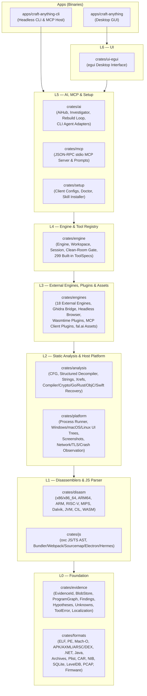

# Craft Anything — 7-Layer Architecture, 11 Golden Rules, Extending & File Formats

This reference synthesizes `AGENTS.md`, `docs/extending.md`, `docs/file-formats.md`, and `crates/engines/wit/plugin.wit`. Use it when contributing to Craft Anything, writing WASM or MCP plugins, or inspecting workspace files.

---

## 1. The 7-Layer Workspace Crate Hierarchy (`AGENTS.md`)

Dependencies flow strictly downward (`L6 → L5 → L4 → L3 → L2 → L1 → L0`). No cycles, no upward imports.



---

## 2. The 11 Golden Architectural Rules (`AGENTS.md`)

1. **One tool registry**: Every capability is a `ToolSpec` registered in `Engine`. The GUI, CLI (`craft-anything-cli call`), MCP server (`tools/call`), and AI agents all call `Engine::call`—no side doors or UI-only logic.
2. **Evidence-first**: Any tool that inspects a target produces an `EvidenceItem` (`ev_...`) and stores large/raw payloads in the content-addressed `BlobStore` (`blobs/sha256/<ab>/<hash>`). Findings require `ev_...` citations.
3. **Clean-room by default**: `crates/engine/src/clean_room.rs` is the single gatekeeper. Unless `deep_mode` is explicitly enabled by the user, internal inspection tools are hidden from catalog listings and refused by `Engine::call`.
4. **Explicit effects & consent**: Every `ToolSpec` declares its `Effects` bitflags (`READ_ONLY`, `WRITES_WORKSPACE`, `WRITES_FILESYSTEM`, `LAUNCHES_PROCESS`, `NETWORK_ACCESS`, `EXECUTES_FOREIGN_CODE`, `MUTATES_DEVICE`, `MAY_DISCARD_DATA`). Calling a tool with `EXECUTES_FOREIGN_CODE` or `MUTATES_DEVICE` without consent returns `ErrorCode::ConsentRequired`.
5. **Works out of the box, richer with external engines**: Built-in pure-Rust parsers and decompilers always work with zero external dependencies; external engines (`crates/engines/src/table.rs`) enrich results when installed.
6. **Pinned, SHA-256-verified downloads only**: Managed external engines (`adb`, `jadx`, `apktool`, `vineflower`, `rizin`, `ghidra`, `java`) use exact versioned HTTPS URLs (never `"latest"`) and verify the publisher's 64-char hex SHA-256 before unpacking.
7. **Strict parameter schemas**: Every tool parameter struct uses `#[derive(Deserialize, JsonSchema)]` and `#[serde(deny_unknown_fields)]` so typos in tool calls fail immediately with a clear error instead of being silently ignored.
8. **Bounded resource consumption**: Every file read, archive unpack, string scan, decompilation, browser watch, and subprocess execution has an explicit size, count, and timeout cap.
9. **Versioned on-disk files**: Every JSON file persisted on disk carries `"format_version": 1` (checked on load, covered by JSON Schemas in `docs/schemas/`).
10. **Secrets stay in OS credential storage or memory**: API keys (Anthropic, OpenAI, OpenRouter, `fal.ai`) are never accepted as CLI arguments (`--key-env` or `--key-stdin` only), never written to `config.toml` or workspace logs, and redacted in debug output.
11. **Tool IDs follow `docs/tool-ids.md`**: `<area>_<object>_<action>`, checked by workspace tests.

---

## 3. Extension Seams (`docs/extending.md`)

| What You Want to Add | Where It Lives | How It Connects |
|---|---|---|
| **A built-in engine tool** | `crates/engine/src/tools/<toolset>.rs` | Add a `ToolSpec` (with `#[serde(deny_unknown_fields)]` param struct), register in `crates/engine/src/tools/mod.rs`, add to `clean_room.rs` ONLY if it observes from outside, and regenerate `docs/tools.md`. |
| **An external binary engine** | `crates/engines/src/table.rs` | Add one `ExternalEngine` entry to `ENGINES` (plus `Pin` with HTTPS URL & SHA-256 if managed) and matching field in `ToolPaths`. |
| **A rebuild stack or UI library** | `crates/ai/src/rebuild/stacks.toml` | Add a `[[stack]]` or `[[library]]` entry with `name`, `kind`, `keywords`, `brief`, and check rules in `crates/ai/src/rebuild/check.rs`. |
| **Arebuild target kind** | `crates/ai/src/rebuild/kinds/` | Implement the `KindSpec` trait (`study`, `checks`, `brief_sections`) and register in `crates/ai/src/rebuild/kinds/mod.rs`. |
| **A coding-agent CLI backend** | `crates/ai/src/cli_agents/adapters/` | Implement `CliAgentAdapter` (`claude_code.rs`, `codex.rs`, `opencode.rs`, `antigravity.rs`) and register in `adapters/mod.rs`. |
| **A coding-agent MCP/Skill client** | `crates/setup/src/clients.rs` | Add a `ClientSpec` entry to `CLIENTS` with config path, format (`JsonMcpServers`, `TomlMcpServers`, etc.), and skill folder. |
| **A game asset model** | `crates/engines/src/assets/assets.toml` | Add an `[[image]]` or `[[model_3d]]` entry with `id`, `provider`, `endpoint`, and USD pricing. |
| **A sandboxed WASM tool or check plugin** | Any `.wasm` component implementing `crates/engines/wit/plugin.wit` | Load at runtime with `plugins_wasm_load` (no recompile of Craft Anything needed). |
| **An external MCP plugin server** | Any stdio MCP server | Connect at runtime with `plugins_mcp_connect` and call via `plugins_mcp_call`. |

---

## 4. Writing WebAssembly Plugins (`crates/engines/wit/plugin.wit`)

Craft Anything runs WebAssembly Component Model (`.wasm` / `wasm32-wasip2` or `wit-bindgen`) plugins in a fuel-bounded Wasmtime sandbox with **zero host capability imports** (cannot read/write host files, spawn processes, or open sockets).

### 4.1 WIT Contract (`resources/plugin.wit`)

```wit
package craft-anything:plugin@0.1.0;

/// A sandboxed tool plugin: describes its tools as JSON and answers calls with JSON.
interface tools {
    describe: func() -> string;
    call: func(name: string, input: string) -> string;
}

/// A sandboxed build-check plugin: inspects a snapshot of `app/` files and returns pass/fail.
interface checks {
    describe: func() -> string;
    run: func(name: string, build: string) -> string;
}

world plugin {
    export tools;
}

world checks-plugin {
    export checks;
}
```

### 4.2 Tool Plugin (`world plugin`)
- `describe()` returns a JSON array of tool descriptors:
  ```json
  [{
    "name": "count_words",
    "title": "Count words",
    "description": "Count the words, lines and characters of a text.",
    "input_schema": {
      "type": "object",
      "properties": { "text": { "type": "string" } },
      "required": ["text"]
    }
  }]
  ```
- `call(name, input)` receives JSON `input` and returns `{"ok": <value>}` or `{"error": "<message>"}`.
- See complete working example in [`examples/wasm-plugin-wordcount/`](../examples/wasm-plugin-wordcount/README.md).

### 4.3 Check Plugin (`world checks-plugin`)
- `describe()` returns a JSON array of check descriptors:
  ```json
  [{
    "name": "readme_says_how_to_run",
    "title": "README says how to run it",
    "description": "The build has a README.md that tells a person how to start it.",
    "kinds": [],
    "extensions": ["md"]
  }]
  ```
  - `kinds`: `[]` for all rebuild kinds, or subset of `["website", "app", "game"]`.
  - `extensions`: File extensions whose text contents should be included in the `build` JSON snapshot (`files: [{ "path": "README.md", "size": 120, "text": "..." }]`).
- `run(name, build)` returns `{"passed": true, "summary": "..."}` or `{"passed": false, "summary": "..."}`.
- Runs automatically during every rebuild `Check` step!
- See complete working example in [`examples/wasm-plugin-readme-check/`](../examples/wasm-plugin-readme-check/README.md).

---

## 5. Versioned On-Disk File Formats (`docs/file-formats.md`)

Full JSON Schemas are included in [`resources/schemas/`](../resources/schemas/):

1. **`craft.json` ([`craft.schema.json`](../resources/schemas/craft.schema.json))**:
   - Lives at `<project_root>/craft.json`.
   - `format_version: 1`.
   - Holds project `name`, `created_at`, `updated_at`, `target`, `rebuild` metadata (`request`, `kind`, `stack`, `existing_files`, `asset_budget_usd`, `assets_spent_usd`, `allow_assets`), working memory (`brief`, `plan`, `hypotheses`, `findings`, `unknowns`, `annotations`, `renames`, `bookmarks`, `tags`, `handoff`), and `graph`.
2. **`reports/build-progress.json` ([`build-progress.schema.json`](../resources/schemas/build-progress.schema.json))**:
   - Tracks rebuild execution state (`step`: `study` / `extract` / `build` / `check` / `refine` / `done`, `round`, `ok`, `paused`, `similarity`, `checks`, `feed`, `questions`).
3. **`app/mechanics.json` ([`mechanics.schema.json`](../resources/schemas/mechanics.schema.json))**:
   - `format_version: 1`.
   - `constants`: array of `{ "name": string, "value": number, "unit"?: string, "source": string }`.
4. **`--self-test <file.json>` ([`self-test.schema.json`](../resources/schemas/self-test.schema.json))**:
   - `format_version: 1`.
   - `passed: boolean`, `frames: integer`, `steps: [{ "name": "move"|"act"|"hud"|string, "passed": boolean, "detail"?: string }]`.
