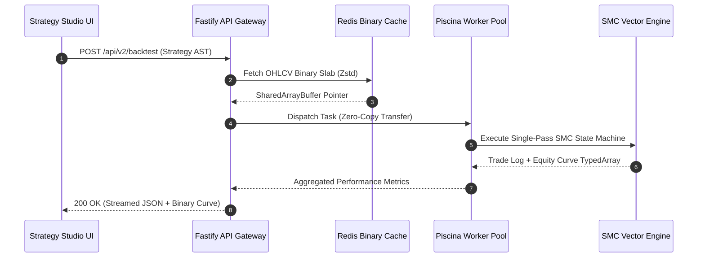

<div class="inline-flex items-center gap-2 px-3 py-1 rounded-full text-xs font-mono uppercase tracking-wider bg-sky-500/15 text-sky-400 border border-sky-500/30 mb-4">
  <span class="w-2 h-2 rounded-full bg-sky-400 animate-pulse"></span>
  System Architecture & Engineering Deep Dive
</div>

# Ultra-Fast SMC Backtest Engine
From 45 Seconds to **320 Milliseconds** Using Vectorized Memory & Worker Pools

<div class="pt-10 flex items-center gap-4 text-sm opacity-80">
  <span>By <strong>Park (Slidev Specialist)</strong></span>
  <span>•</span>
  <span class="font-mono text-xs px-2.5 py-1 rounded bg-white/10">v2.4 Architecture</span>
</div>

<div class="abs-br m-6 flex gap-2">
  <span class="text-xs opacity-50 font-mono">Press <kbd>Space</kbd> to advance</span>
</div>

<!--
สวัสดีครับทุกคน วันนี้เราจะมาผ่าสถาปัตยกรรมของระบบ Smart Money Concepts (SMC) Backtest Engine รุ่นใหม่ ที่ลดเวลาประมวลผลจาก 45 วินาที ลงมาเหลือเพียง 320 มิลลิวินาทีกันครับ
-->

---
layout: fact
transition: fade
---

# 140x
Throughput Acceleration on 1,000,000 M1 Candles

<div class="mt-4 text-base opacity-70 max-w-xl mx-auto">
  Zero-copy <code class="text-sky-400">SharedArrayBuffer</code> pipelines combined with deterministic state machines
</div>

<!--
ตัวเลขสำคัญที่เราทำได้ในเวอร์ชันนี้คือความเร็วที่เพิ่มขึ้นถึง 140 เท่า บนข้อมูลแท่งเทียน 1 ล้านแท่งครับ
-->

---
layout: two-cols-header
layoutClass: gap-8
---

# Why the Legacy Engine Hit a Wall
เปรียบเทียบคอขวดของระบบเดิม (v1) กับแนวคิดการออกแบบใหม่ (v2)

::left::

<div class="p-5 rounded-2xl bg-rose-950/30 border border-rose-500/30 h-full">
  <div class="text-xs font-mono uppercase tracking-wider text-rose-400 mb-2">Legacy Engine (v1)</div>
  <h3 class="text-lg font-bold mb-3">Row-by-Row Object Allocation</h3>
  <v-clicks>
    <ul class="space-y-2 text-sm opacity-85">
      <li>❌ สร้าง JSON Object ใหม่ทุกๆ แท่งเทียน (GC Pause หนักมาก)</li>
      <li>❌ ค้นหา Order Block ย้อนหลังแบบ $O(N^2)$ Nested Loop</li>
      <li>❌ ดึงข้อมูลผ่าน ORM ทีละ Batch ช้าและกิน RAM สูงถึง 2.4 GB</li>
    </ul>
  </v-clicks>
</div>

::right::

<div v-click class="p-5 rounded-2xl bg-emerald-950/30 border border-emerald-500/30 h-full">
  <div class="text-xs font-mono uppercase tracking-wider text-emerald-400 mb-2">Next-Gen Engine (v2)</div>
  <h3 class="text-lg font-bold mb-3">Columnar TypedArrays & Ring Buffers</h3>
  <ul class="space-y-2 text-sm opacity-85">
    <li>✅ จัดเก็บ OHLCV ใน <span v-mark.underline.emerald="4">Float64Array</span> ต่อเนื่องในหน่วยความจำ</li>
    <li>✅ อัลกอริทึมตรวจจับ FVG / BOS แบบ Single-Pass $O(N)$</li>
    <li>✅ ใช้หน่วยความจำคงที่เพียง <span v-mark.circle.amber="5">48 MB</span> ตลอดการรัน</li>
  </ul>
</div>

<!--
[click] ในระบบเดิม เราสร้าง Object แท่งเทียนทีละแถว ทำให้ Garbage Collector ทำงานหนักมาก
[click] แถมการเช็ก Order Block ย้อนหลังยังเป็น Nested Loop O(N^2)
[click] จนกิน RAM ทะลุ 2.4 GB
[click] ใน v2 เราเปลี่ยนมาใช้โครงสร้างข้อมูลแบบ Columnar ด้วย Float64Array
[click] และลดการใช้ RAM ลงเหลือเพียง 48 MB เท่านั้นครับ
-->

---
layout: center
---

# End-to-End Execution Pipeline
สถาปัตยกรรมการไหลของข้อมูลตั้งแต่ API Gateway จนถึง Worker Threads



---

# Code Evolution: From $O(N^2)$ Objects to $O(N)$ TypedArrays
ดูการเปลี่ยนแปลงโค้ดทีละสเต็ปด้วย **Shiki Magic Move** (กด Space เพื่อดูโค้ดแปลงร่าง)

````md magic-move {lines: true}
```ts {1-9}
// Step 1: Legacy v1 — Allocating objects & scanning backwards
function detectFairValueGaps(candles: CandleObject[]): FVG[] {
  const gaps: FVG[] = []
  for (let i = 2; i < candles.length; i++) {
    const c0 = candles[i - 2]
    const c2 = candles[i]
    if (c2.low > c0.high) {
      gaps.push({ index: i - 1, top: c2.low, bottom: c0.high, mitigated: false })
    }
  }
  return gaps
}
```

```ts {1-14}
// Step 2: Columnar Float64Array — Zero heap allocations inside hot loop!
export interface ColumnarOHLCV {
   readonly high: Float64Array
  readonly low: Float64Array
  readonly length: number
}

export function detectBullishFVG(data: ColumnarOHLCV, outTop: Float64Array, outBottom: Float64Array): number {
  const { high, low, length } = data
  let count = 0
  for (let i = 2; i < length; i++) {
    const gapBottom = high[i - 2]
    const gapTop = low[i]
    if (gapTop > gapBottom) {
      outTop[count] = gapTop
      outBottom[count] = gapBottom
      count++
    }
  }
  return count
}
```
````

---
layout: two-cols
layoutClass: gap-8 items-center
---

# Quantitative Risk & Kelly Criterion
การคำนวณขนาดไม้ (Position Sizing) และความได้เปรียบเชิงสถิติด้วย **KaTeX**

สมการ **Expected Value ($EV$)** และ **Optimal Kelly Fraction ($f^*$)** ที่รันอยู่ในโมดูล Risk Guard:

$$ {1|2|3|all}
\begin{aligned}
\mathbb{E}[R] &= P_{\text{win}} \cdot \overline{R}_{\text{win}} - (1 - P_{\text{win}}) \cdot \overline{R}_{\text{loss}} \\
f^* &= \frac{P_{\text{win}} \cdot b - (1 - P_{\text{win}})}{b}, \quad b = \frac{\overline{W}}{\overline{L}} \\
\text{Sharpe} &= \sqrt{N_{\text{trades}}} \cdot \frac{\mu_{R} - R_f}{\sigma_{R}}
\end{aligned}
$$

::right::

<div class="p-6 rounded-2xl bg-slate-900/80 border border-slate-700/70">
  <h3 class="text-base font-bold text-sky-400 mb-3">Live Risk Calculator ({monaco-run})</h3>

```ts {monaco-run} {autorun:true}
const winRate = 0.62
const rewardToRisk = 2.5
const lossRate = 1 - winRate

const kelly = (winRate * rewardToRisk - lossRate) / rewardToRisk
const halfKelly = (kelly / 2 * 100).toFixed(2)

console.log(`Full Kelly: ${(kelly * 100).toFixed(2)}%`)
console.log(`Safe Half-Kelly Risk: ${halfKelly}% per trade`)
```
</div>

---
layout: end
---

# Thank You & Q&A
Ready to Scale Your Quantitative Infrastructure

<div class="mt-6 flex justify-center gap-6 text-sm">
  <span class="px-4 py-2 rounded-xl bg-white/5 border border-white/10">
    <carbon-logo-github class="inline mr-1" /> github.com/org/smc-backtest-engine
  </span>
  <span class="px-4 py-2 rounded-xl bg-white/5 border border-white/10">
    <carbon-document class="inline mr-1" /> Built with Slidev
  </span>
</div>

<PoweredBySlidev class="mt-8 opacity-60" />
