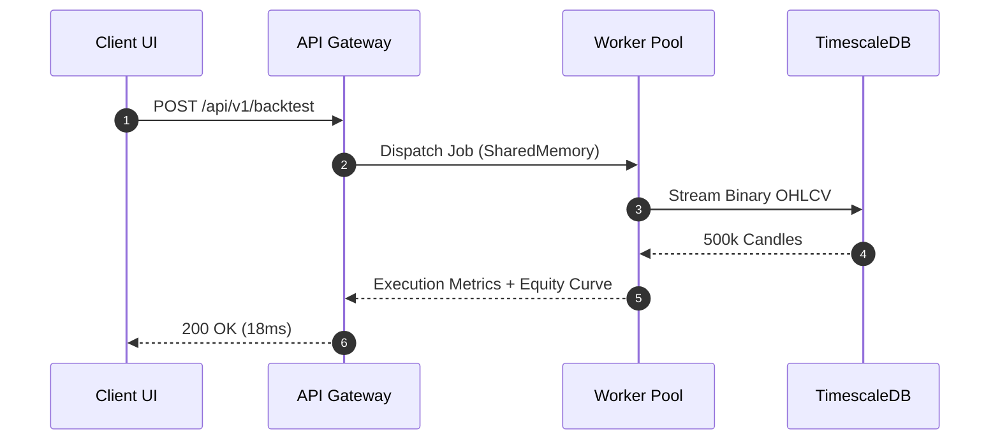
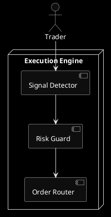

# Advanced Code Blocks, Diagrams & LaTeX Math Reference

คู่มือเจาะลึกการแสดงผลโค้ดระดับมืออาชีพใน Slidev ด้วย **Shiki**, **Line Highlighting**, **Shiki Magic Move**, **TwoSlash**, **Monaco Editor**, การดึงโค้ดจากไฟล์จริง (`<<<`), ไดอะแกรม **Mermaid / PlantUML**, และสมการคณิตศาสตร์ **KaTeX**

---

## 1. Shiki Syntax Highlighting & Line Highlighting (`{...}`)

Slidev ใช้ **Shiki** เป็นเครื่องมือทำ Syntax Highlighting ที่ให้ความแม่นยำเทียบเท่า VS Code พร้อมความสามารถในการไฮไลต์บรรทัดโค้ดตามสเต็ปการคลิก (`|`):

### 1.1 ไวยากรณ์การไฮไลต์บรรทัดและสเต็ปคลิก
ใส่หมายเลขบรรทัดไว้ในวงเล็บปีกกา `{...}` หลังชื่อภาษาของ Code Block:
- `,` คั่นบรรทัดหรือช่วงบรรทัดในสเต็ปเดียวกัน (เช่น `{1,3,5-7}`)
- `|` คั่นสเต็ปการคลิก (`v-click`) ถัดไป
- `all` ไฮไลต์ทุกบรรทัด
- `none` หรือ `hide` ไม่ไฮไลต์บรรทัดใดเลย (หรือซ่อนบล็อกโค้ดในสเต็ปนั้น)

````markdown
```ts {2-3|5-8|10|all}
interface OrderSignal {
  symbol: string
  direction: 'LONG' | 'SHORT'
}

export function evaluateRisk(signal: OrderSignal, balance: number) {
  const maxRisk = balance * 0.01
  return { ...signal, maxRisk }
}

// Ready for execution
```
````
- **ตอนเปิดสไลด์ครั้งแรก**: ไฮไลต์บรรทัดที่ `2-3` (บรรทัดอื่นจะถูกหรี่แสงลง)
- **คลิกที่ 1**: ย้ายไฮไลต์ไปที่บรรทัด `5-8`
- **คลิกที่ 2**: ย้ายไฮไลต์ไปที่บรรทัด `10`
- **คลิกที่ 3**: ไฮไลต์ทุกบรรทัด (`all`)

### 1.2 ตัวเลือกเพิ่มเติมใน `{...}` (Code Block Options)
คุณสามารถส่ง Options เสริมควบคู่กับการไฮไลต์บรรทัดได้:

````markdown
```ts {1-3|5-7}{lines:true, startLine:10, maxHeight:'280px', at:2}
// โค้ดนี้จะแสดงเลขบรรทัดโดยเริ่มนับที่บรรทัด 10
// จำกัดความสูงไว้ที่ 280px (เลื่อน Scroll อัตโนมัติเมื่อไฮไลต์บรรทัดด้านล่าง!)
// และเริ่มทำงานที่คลิกลำดับที่ 2 ของสไลด์ (at:2)
```
````
- `lines: true | false`: เปิด/ปิดการแสดงเลขบรรทัดเฉพาะบล็อกนี้
- `startLine: number`: กำหนดเลขบรรทัดเริ่มต้น
- `maxHeight: string`: กำหนดความสูงสูงสุดของบล็อกโค้ด (เช่น `'300px'`) เมื่อไฮไลต์บรรทัดที่อยู่ข้างล่าง Slidev จะ **Auto-scroll** บล็อกโค้ดลงไปหาบรรทัดนั้นอย่างนุ่มนวล!
- `at: number | string`: กำหนดลำดับคลิกเริ่มต้นของบล็อกโค้ดนี้

---

## 2. Shiki Magic Move (อนิเมชันแปลงร่างโค้ดขั้นเทพ)

**Shiki Magic Move** เป็นฟีเจอร์ระดับเรือธงของ Slidev ที่ช่วยทำอนิเมชัน Morphing ตัวอักษรและโทเคนของโค้ดจากเวอร์ชันหนึ่งไปยังอีกเวอร์ชันหนึ่งอย่างลื่นไหลเมื่อกดคลิก

### วิธีใช้งาน:
ล้อมบล็อกโค้ดหลายๆ อันด้วย Backticks 4 ตัว ```` ````md magic-move ````:

`````markdown
````md magic-move {lines: true}
```ts {1-3}
// Step 1: Naive synchronous fetch
function loadCandles(symbol: string) {
  return db.query(`SELECT * FROM candles WHERE symbol = '${symbol}'`)
}
```

```ts {1-5}
// Step 2: Parameterized async query with validation
async function loadCandles(symbol: string, limit = 1000): Promise<Candle[]> {
  return await db.query(
    'SELECT * FROM candles WHERE symbol = $1 LIMIT $2',
    [symbol, limit]
  )
}
```

```ts {1-8}
// Step 3: Redis read-through cache + binary decoding
async function loadCandles(symbol: string, limit = 1000): Promise<Float64Array> {
  const cached = await redis.getBuffer(`candles:${symbol}:${limit}`)
  if (cached) return new Float64Array(cached.buffer)

  const rows = await db.query('SELECT * FROM candles WHERE symbol = $1 LIMIT $2', [symbol, limit])
  return encodeToFloat64(rows)
}
```
````
`````
- คุณสามารถเปลี่ยนภาษาของโค้ดข้ามสเต็ปได้ด้วย (เช่น จาก `.js` ไปเป็น `.ts` หรือ `.vue`)
- สามารถใส่ `{1-3|4-6}` ในแต่ละบล็อกโค้ดย่อยภายใน `magic-move` ได้ตามปกติ!

---

## 3. TwoSlash Integration (แสดง TypeScript Types บนสไลด์)

เติมคำว่า `twoslash` หลังชื่อภาษา (`ts` หรือ `tsx`) เพื่อให้คอมไพเลอร์ TypeScript ตรวจสอบชนิดตัวแปรและสร้างป้ายบอก Type หรือ Tooltip บนสไลด์:

````markdown
```ts twoslash
import { computed, ref } from 'vue'

const price = ref(2650.50)
const leverage = ref(20)
// ---cut---
// โค้ดเหนือบรรทัด ---cut--- จะถูกใช้คำนวณ Type แต่ไม่แสดงผลบนสไลด์!
const positionValue = computed(() => price.value * leverage.value)
//    ^?
```
````
- เครื่องหมาย `// ^?` จะสั่งให้แสดงกล่องข้อความบอกชนิดตัวแปร (`const positionValue: ComputedRef<number>`) ค้างไว้บนสไลด์ทันที!
- เครื่องหมาย `// ---cut---` ใช้ซ่อนโค้ดส่วน Setup/Import ด้านบนที่ไม่ต้องการให้รกหน้าสไลด์

---

## 4. Monaco Editor (แก้ไขและรันโค้ดสดบนสไลด์)

เปลี่ยนบล็อกโค้ดนิ่งๆ ให้กลายเป็น **VS Code Monaco Editor** เต็มรูปแบบ:

### 4.1 `{monaco}` — แก้ไขโค้ดสดบนหน้าจอ
````markdown
```ts {monaco}
// ผู้พูดสามารถพิมพ์แก้ไขโค้ดนี้สดๆ ระหว่างบรรยาย พร้อม Autocomplete!
const greet = (name: string) => `Hello, ${name}!`
```
````

### 4.2 `{monaco-run}` — แก้ไขและกดปุ่ม Run แสดงผลลัพธ์ทันที!
รองรับการรันโค้ด `js` และ `ts` ในตัว (และสามารถเพิ่มภาษาอื่นผ่าน `setup/code-runners.ts`):

````markdown
```ts {monaco-run} {autorun:true, height:'240px'}
const prices = [100, 105, 102, 110, 108]
const returns = prices.slice(1).map((p, i) => ((p - prices[i]) / prices[i] * 100).toFixed(2) + '%')
console.log('Period Returns:', returns)
```
````
- `autorun: true` (ค่าเริ่มต้น): รันโค้ดทันทีเมื่อเปิดสไลด์หรือแก้ไขโค้ด
- `autorun: false`: แสดงปุ่ม Play ให้กดรันเอง

### 4.3 `{monaco-diff}` — เปรียบเทียบโค้ด Before vs After (Diff View)
คั่นโค้ดต้นฉบับและโค้ดที่แก้ไขแล้วด้วย `~~~`:

````markdown
```ts {monaco-diff}
function calculateFee(amount: number) {
  return amount * 0.02
}
~~~
function calculateFee(amount: number, tier: 'VIP' | 'STD' = 'STD') {
  const rate = tier === 'VIP' ? 0.005 : 0.02
  return Math.max(1, amount * rate)
}
```
````

---

## 5. การดึงโค้ดจากไฟล์จริง (`<<< @/filepath`)

ไม่ต้องก๊อปวางโค้ดซ้ำซ้อน! คุณสามารถอ้างอิงโค้ดจากไฟล์ในโปรเจกต์ได้โดยตรง (โดย `@` แทนโฟลเดอร์รากของโปรเจกต์สไลด์):

```markdown
<!-- ดึงทั้งไฟล์ พร้อมไฮไลต์บรรทัด 2-5 -->
<<< @/snippets/order-book.ts {2-5|8-12}

<!-- ดึงเฉพาะส่วนที่ครอบด้วย //#region matching และเปิดโหมด monaco -->
<<< @/snippets/order-book.ts#matching {monaco}
```

---

## 6. ไดอะแกรมด้วย Mermaid & PlantUML

### 6.1 Mermaid Diagrams (` ```mermaid `)
เขียนไดอะแกรมด้วยบล็อก `mermaid` พร้อมกำหนด `theme` และ `scale` ในวงเล็บปีกกา `{...}`:

````markdown

````

### 6.2 การปรับแต่งสี Mermaid ทั้งโปรเจกต์ (`setup/mermaid.ts`)
```ts
// setup/mermaid.ts
import { defineMermaidSetup } from '@slidev/types'

export default defineMermaidSetup(() => {
  return {
    theme: 'base',
    themeVariables: {
      primaryColor: '#1e293b',
      primaryTextColor: '#f8fafc',
      primaryBorderColor: '#38bdf8',
      lineColor: '#94a3b8',
      secondaryColor: '#0f172a',
      tertiaryColor: '#334155',
    },
  }
})
```

### 6.3 PlantUML Diagrams (` ```plantuml `)
````markdown

````

---

## 7. สมการคณิตศาสตร์และเคมีด้วย KaTeX (`$...$` & `$$...$$`)

Slidev รองรับการเขียนสมการ LaTeX ด้วย **KaTeX** ทั้งแบบ Inline และแบบ Block พร้อมรองรับการไฮไลต์บรรทัดสมการ!

### 7.1 Inline Math
```markdown
อัตราส่วน Sharpe Ratio คำนวณจาก $S_a = \frac{E[R_a - R_b]}{\sigma_a}$ โดยที่ $\sigma_a$ คือส่วนเบี่ยงเบนมาตรฐาน
```

### 7.2 Block Math พร้อม Line Highlighting (`{1|2|all}`)
```markdown
$$ {1|2|all}
\begin{aligned}
\text{Expected Value (EV)} &= (P_{\text{win}} \times \overline{W}) - (P_{\text{loss}} \times \overline{L}) \\
\text{Kelly Fraction } (f^*) &= \frac{p \cdot b - q}{b} = p - \frac{q}{b}
\end{aligned}
$$
```

### 7.3 สมการเคมี (`mhchem` extension ในตัว)
```markdown
$$\ce{CO2 + C -> 2 CO}$$
```
