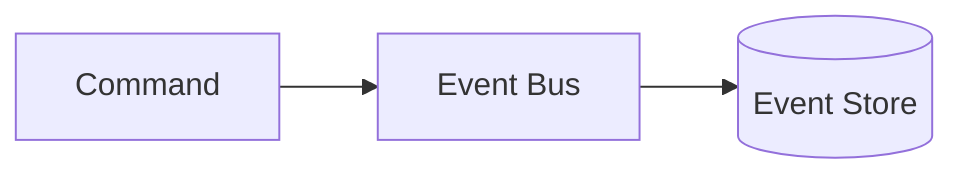

# Styling, Themes, Custom Vue Components & Exporting Reference

คู่มือเจาะลึกการตกแต่งสไลด์ระดับพรีเมียมด้วย **UnoCSS**, การสร้าง **Custom Layouts & Components**, การใช้งาน **Global Layers (`global-top.vue`, `global-bottom.vue`)**, การเลือกใช้ **Themes & Addons**, และการ **Export (PDF / PPTX / PNG / SPA Deployment)**

---

## 1. การตกแต่งสไลด์ระดับพรีเมียมด้วย UnoCSS (`uno.config.ts`)

Slidev ขับเคลื่อนด้วย **UnoCSS** (รองรับคลาสทั้งหมดของ Tailwind CSS v3 + Windi CSS + Iconify) คุณสามารถสร้างไฟล์ `uno.config.ts` ที่รากของโปรเจกต์เพื่อสร้าง **Design Tokens & Shortcuts** สำหรับใช้ซ้ำในทุกสไลด์:

```ts
// uno.config.ts
import { defineConfig } from 'unocss'

export default defineConfig({
  shortcuts: {
    // 1. พื้นหลังและการ์ดแบบ Glassmorphism
    'glass-card': 'bg-white/5 dark:bg-slate-900/60 backdrop-blur-md border border-white/10 dark:border-slate-700/60 rounded-2xl shadow-xl p-6',
    'glass-card-hover': 'glass-card transition-all duration-300 hover:border-sky-500/50 hover:shadow-sky-500/10 hover:-translate-y-1',

    // 2. ป้ายกำกับหัวข้อ (Eyebrow Pill Badge)
    'badge-pill': 'inline-flex items-center gap-1.5 px-3 py-1 rounded-full text-xs font-mono uppercase tracking-wider bg-sky-500/10 text-sky-400 border border-sky-500/25',

    // 3. ข้อความไล่เฉดสี (Gradient Headlines)
    'text-gradient-sky': 'bg-gradient-to-r from-sky-400 via-cyan-300 to-indigo-400 bg-clip-text text-transparent',
    'text-gradient-gold': 'bg-gradient-to-r from-amber-200 via-yellow-400 to-orange-400 bg-clip-text text-transparent',

    // 4. กล่องแสดงตัวเลข KPI (Metric Stat Box)
    'stat-value': 'text-5xl font-extrabold tracking-tight text-gradient-sky',
    'stat-label': 'text-xs font-medium uppercase tracking-widest opacity-60 mt-1',
  },
})
```

### เทคนิคจัดวาง Bento Grid บนสไลด์
แทนที่จะใช้ Bullet List ธรรมดา ให้ใช้ CSS Grid (`grid-cols-3` หรือ `grid-cols-12`) สร้าง Bento Box ที่ดูทันสมัยสไตล์ Apple / Linear:

```markdown
<div class="grid grid-cols-3 gap-4 mt-6">
  <div class="col-span-2 glass-card">
    <div class="badge-pill mb-2">Core Engine</div>
    <h3 class="text-xl font-bold mb-1">Vectorized Candle Processor</h3>
    <p class="text-sm opacity-75">Zero-allocation ring buffers processing 2.4M ticks/sec in pure TypeScript.</p>
  </div>
  <div class="glass-card flex flex-col justify-center items-center text-center">
    <div class="stat-value">0.4ms</div>
    <div class="stat-label">P99 Latency</div>
  </div>
</div>
```

---

## 2. การสร้าง Custom Vue Components (`./components/`)

ไฟล์ `.vue` ทุกไฟล์ที่วางอยู่ในโฟลเดอร์ `./components/` จะถูก **Auto-import** ให้เรียกใช้ใน `slides.md` ได้ทันที:

```vue
<!-- components/MetricCard.vue -->
<script setup lang="ts">
defineProps<{
  title: string
  value: string | number
  delta?: string
  positive?: boolean
}>()
</script>

<template>
  <div class="p-5 rounded-2xl bg-slate-900/70 border border-slate-700/60 backdrop-blur-md">
    <div class="text-xs uppercase tracking-wider text-slate-400">{{ title }}</div>
    <div class="text-4xl font-bold text-white my-2">{{ value }}</div>
    <div
      v-if="delta"
      class="text-xs font-mono inline-block px-2 py-0.5 rounded"
      :class="positive ? 'bg-emerald-500/20 text-emerald-300' : 'bg-rose-500/20 text-rose-300'"
    >
      {{ delta }}
    </div>
  </div>
</template>
```

เรียกใช้ใน `slides.md`:
```markdown
<div class="grid grid-cols-3 gap-6 mt-8">
  <MetricCard title="Win Rate" value="68.4%" delta="+12.1% vs Baseline" :positive="true" />
  <MetricCard title="Profit Factor" value="2.84" delta="+0.65 Sharpe" :positive="true" />
  <MetricCard title="Max Drawdown" value="4.12%" delta="-3.8% Risk Reduced" :positive="true" />
</div>
```

---

## 3. การสร้าง Custom Layouts (`./layouts/`)

หากต้องการสร้าง Layout เฉพาะองค์กร ให้สร้างไฟล์ `.vue` ในโฟลเดอร์ `./layouts/` เช่น `./layouts/split-showcase.vue`:

```vue
<!-- layouts/split-showcase.vue -->
<script setup lang="ts">
defineProps<{
  badge?: string
}>()
</script>

<template>
  <div class="slidev-layout split-showcase h-full grid grid-cols-12 gap-8 items-center px-12 py-10">
    <div class="col-span-5 flex flex-col justify-center">
      <span v-if="badge" class="text-xs font-mono uppercase tracking-widest text-sky-400 mb-2">
        {{ badge }}
      </span>
      <!-- Default slot สำหรับเนื้อหาฝั่งซ้าย -->
      <slot />
    </div>
    <div class="col-span-7 h-full flex items-center justify-center bg-slate-900/50 rounded-2xl p-6 border border-white/10">
      <!-- Named slot ::showcase:: สำหรับเนื้อหาฝั่งขวา -->
      <slot name="showcase" />
    </div>
  </div>
</template>
```

เรียกใช้ใน `slides.md`:
```markdown
---
layout: split-showcase
badge: Architecture Pattern
---

# Event Sourcing
แยกส่วนเนื้อหาคำอธิบายไว้ทางซ้าย

::showcase::


```

---

## 4. Global Layers (`global-top.vue` & `global-bottom.vue`)

เมื่อต้องการแสดง **โลโก้องค์กร**, **Progress Bar**, หรือ **หมายเลขหน้า (Slide Number Footer)** ในทุกสไลด์โดยไม่ต้องก๊อปวางซ้ำ และไม่ถูกรีเซ็ตเมื่อเปลี่ยนหน้าสไลด์:

```vue
<!-- global-bottom.vue (วางไว้ที่รากของโปรเจกต์) -->
<template>
  <!-- ซ่อน Footer ในหน้าแรก (Cover) และหน้าสุดท้าย (End) -->
  <footer
    v-if="$nav.currentLayout !== 'cover' && $nav.currentLayout !== 'end'"
    class="absolute bottom-0 left-0 right-0 px-8 py-3 flex justify-between items-center text-xs opacity-50 pointer-events-none z-10"
  >
    <div class="flex items-center gap-2 font-mono">
      <span class="w-2 h-2 rounded-full bg-emerald-400"></span>
      <span>SMC Backtest Engine Architecture</span>
    </div>
    <div class="font-mono">
      {{ $nav.currentPage }} / {{ $nav.total }}
    </div>
  </footer>
</template>
```

---

## 5. ยอดนิยม Slidev Themes & Addons

### 5.1 Official & Community Themes
ระบุใน Headmatter ด้วย `theme: <name>`:
- `default`: ธีมมาตรฐานของ Slidev สะอาดตา ทันสมัย
- `seriph`: ธีมทางการสุดหรูหรา ผสมผสานฟอนต์ Serif และ Sans-serif อย่างลงตัว
- `apple-basic`: ธีมมินิมอลที่ได้แรงบันดาลใจจากสไลด์ Keynote ของ Apple
- `bricks`: ธีมสำหรับงาน Tech Conference และเอกสารโครงสร้างระบบ
- `shibainu` / `dracula` / `geist`: ธีมโทนมืดสำหรับสาย Developer

### 5.2 การใช้ Addons
สามารถติดตั้ง Addon เสริมความสามารถได้ผ่าน Headmatter:
```yaml
---
addons:
  - slidev-addon-qrcode
  - slidev-addon-tldraw
---
```

---

## 6. การส่งออกสไลด์ (Exporting: PDF, PPTX, PNG) และการ Deploy SPA

### 6.1 การติดตั้ง Exporter Dependency
การส่งออกเป็น PDF, PPTX หรือ PNG ใช้ **Playwright Chromium** ในการเรนเดอร์สไลด์แต่ละหน้าอย่างแม่นยำ ต้องติดตั้งแพ็กเกจนี้ในโปรเจกต์ (หรือ Global):
```bash
npm i -D playwright-chromium
```

### 6.2 คำสั่งและ Flags สำคัญของ `slidev export`

```bash
# 1. ส่งออกเป็น PDF มาตรฐาน
npx slidev export

# 2. ส่งออกเป็น PDF พร้อมแยกทุกสเต็ปของ v-click และโค้ด Magic Move เป็นคนละหน้า!
npx slidev export --with-clicks

# 3. ส่งออกเป็นไฟล์ PowerPoint (.pptx) โดยแต่ละหน้าสไลด์เป็นภาพความละเอียดสูงที่เปิดใน PowerPoint ได้ทันที
npx slidev export --format pptx --with-clicks

# 4. ส่งออกสไลด์แต่ละหน้าเป็นไฟล์รูปภาพ PNG
npx slidev export --format png

# 5. ตัวเลือกเสริมขั้นสูง
npx slidev export \
  --output dist/architecture-deck.pdf \
  --dark \
  --with-clicks \
  --With-toc \
  --range 1,3-8,12 \
  --timeout 60000 \
  --wait 1000 \
  --wait-until networkidle
```

| Flag | คำอธิบาย |
| :--- | :--- |
| `--format <pdf\|pptx\|png\|md>` | รูปแบบไฟล์ที่ต้องการส่งออก (ค่าเริ่มต้นคือ `pdf`) |
| `--with-clicks` / `-c` | ส่งออกทุกจังหวะการคลิก (`v-click`) แยกเป็นหน้าสไลด์ย่อย |
| `--dark` | บังคับเรนเดอร์ในโหมด Dark Mode |
| `--range <range>` | เลือกส่งออกเฉพาะหน้าที่ต้องการ เช่น `1,4-7,10` |
| `--timeout <ms>` | เพิ่มเวลารอต่อหน้าสไลด์ (มีประโยชน์มากเมื่อมี Mermaid หรือ Monaco หลายหน้า) |
| `--wait <ms>` | หน่วงเวลาเพิ่มเติม (เป็นมิลลิวินาที) หลังโหลดสไลด์เสร็จก่อนแคปหน้าจอ |
| `--with-toc` | สร้าง PDF Outline / Bookmarks จากโครงสร้างหัวข้อสไลด์ |
| `--executable-path <path>` | ระบุ Path ของเบราว์เซอร์ Chrome/Edge ในเครื่องแทนการโหลด Chromium ใหม่ |

---

### 6.3 การ Build เป็น Static SPA (`slidev build`) เพื่อโฮสต์บนเว็บ

```bash
# Build สไลด์เป็นเว็บแอปพลิเคชันลงโฟลเดอร์ dist/
npx slidev build

# กรณีต้องการโฮสต์ไว้ใน Sub-path (เช่น https://username.github.io/my-slides/)
npx slidev build --base /my-slides/

# Build พร้อมสั่งสร้างไฟล์ PDF แนบไปกับปุ่ม Download บนหน้าเว็บอัตโนมัติ!
npx slidev build --download
```

#### การตั้งค่า SPA Routing สำหรับ Netlify / Vercel
เมื่อใช้ `slidev build` แนะนำให้สร้างไฟล์ `public/_redirects` (สำหรับ Netlify/Cloudflare) หรือ `vercel.json` เพื่อให้รองรับ SPA History Routing:
```text
/* /index.html 200
```
