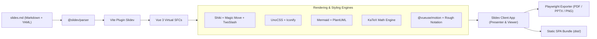

# Why Slidev & Core Architecture Concepts

เอกสารสรุปเจาะลึกแนวคิดเบื้องหลัง **Slidev** (จาก [https://sli.dev/guide/why](https://sli.dev/guide/why)) พร้อมสถาปัตยกรรมภายใน โครงสร้างโปรเจกต์ และระบบ Context API สำหรับนักพัฒนา

---

## 1. ปัญหาของเครื่องมือสร้างสไลด์แบบเดิม vs ทางออกด้วย Slidev

เมื่อนักพัฒนาซอฟต์แวร์ สถาปนิกระบบ (System Architects) หรือ Tech Speakers ต้องทำสไลด์ด้วยเครื่องมือแบบ WYSIWYG (เช่น PowerPoint, Keynote, Google Slides) มักเผชิญกับปัญหาคลาสสิกเหล่านี้:
- การวางโค้ดลงในสไลด์ทำให้เสีย Syntax Highlighting หรือจัดย่อหน้าพังทันทีที่แก้ไข
- ไม่สามารถไฮไลต์บรรทัดโค้ดทีละสเต็ป หรือทำอนิเมชันเมื่อโค้ดถูก Refactor ได้อย่างลื่นไหล
- การวาด Flowchart / Sequence Diagram ด้วยมือใช้เวลานานและแก้ไขยากเมื่อสถาปัตยกรรมเปลี่ยน
- ไฟล์ไบนารี (`.pptx`, `.key`) ไม่สามารถทำ Git Diff, Code Review หรือ Merge ร่วมกับทีมได้
- ไม่สามารถฝัง UI Component จริงๆ หรือรันโค้ดสดๆ (Live Coding) บนหน้าสไลด์ได้

**Slidev** (ย่อมาจาก **Sli**de + **Dev**eloper, ออกเสียงว่า `/slaɪdɪv/`) สร้างขึ้นโดย **Anthony Fu** เพื่อผสานโลกของ **Markdown Content Authoring** เข้ากับพลังของ **Modern Web Ecosystem (Vue 3 + Vite + UnoCSS)**

---

## 2. แปดเสาหลักของ Slidev (The 8 Core Pillars)

### 2.1 📝 Markdown-based (โฟกัสที่เนื้อหา 100%)
- สไลด์ทั้งชุดอยู่ในไฟล์ข้อความธรรมดา (`slides.md`) โดยใช้ `---` คั่นแต่ละสไลด์
- แยก **เนื้อหา (Content)** ออกจาก **การจัดวางและสไตล์ (Presentation & Styling)** อย่างชัดเจน
- เขียนด้วย Code Editor ที่คุ้นเคย (VS Code, Cursor, Neovim) พร้อมส่วนขยาย Slidev VS Code Extension ที่ช่วย Preview สไลด์และจัดลำดับหน้าแบบ Drag-and-Drop

### 2.2 🎨 Themable (เปลี่ยนธีมด้วยคอนฟิกบรรทัดเดียว)
- ธีมของ Slidev ถูกเผยแพร่เป็นแพ็กเกจ npm มาตรฐาน
- เพียงระบุ `theme: seriph` หรือ `theme: apple-basic` ใน Headmatter ระบบจะดาวน์โหลดและติดตั้งธีมให้อัตโนมัติ
- รองรับการใช้ **Slidev Addons** เพื่อเพิ่มฟีเจอร์หรือชุด Component เฉพาะทางร่วมกับธีมหลัก

### 2.3 💻 Developer Friendly (เกิดมาเพื่อคนเขียนโค้ด)
- **Shiki Syntax Highlighter**: ให้สีโค้ดที่แม่นยำระดับเดียวกับ VS Code รองรับทั้ง Light/Dark Theme
- **Line Highlighting & Click Steps**: ไฮไลต์บรรทัดโค้ดตามจังหวะการคลิก เช่น ```` ```ts {1-2|4-6|all} ````
- **Shiki Magic Move**: ทำอนิเมชัน Morphing เปลี่ยนแปลงโค้ดจากสเต็ปหนึ่งไปอีกสเต็ปหนึ่งอย่างนุ่มนวลระดับ Keynote Magic Move
- **TwoSlash Integration**: แสดงผล Type Information, Hover Tooltip และ Compiler Error ของ TypeScript บนโค้ดในสไลด์โดยตรง
- **Monaco Editor & Runner**: เปลี่ยนบล็อกโค้ดธรรมดาให้เป็นตัวแก้ไขโค้ด VS Code (Monaco) ที่พิมพ์แก้และกดรันผลลัพธ์สดๆ บนสไลด์ได้ทันที

### 2.4 ⚡ Fast & Instant HMR (ขับเคลื่อนด้วย Vite)
- ใช้ **Vite** เป็น Bundler และ Dev Server
- โหลดเฉพาะสไลด์ที่กำลังใช้งานและสไลด์ถัดไป (On-demand compilation & Preloading)
- ทุกการแก้ไขใน `slides.md`, ไฟล์ `.vue` หรือ CSS จะแสดงผลบนเบราว์เซอร์ทันทีผ่าน **Hot Module Replacement (HMR)** โดยไม่รีเซ็ตสถานะสไลด์ปัจจุบัน

### 2.5 🧩 Interactive & Expressive (พลังของ Vue 3 เต็มสูบ)
- ทุกสไลด์ถูกคอมไพล์เป็น **Vue 3 Single-File Component** เบื้องหลัง
- สามารถเขียน HTML, Vue Template Syntax (`v-if`, `v-for`, `{{ state }}`), หรือใส่ `<script setup>` ลงในสไลด์ได้โดยตรง
- สร้าง Custom Component ในโฟลเดอร์ `components/` แล้วเรียกใช้ใน Markdown ได้ทันทีโดยไม่ต้อง `import` (Auto-imported via `unplugin-vue-components`)

### 2.6 🎥 Recording & Presenter Support (พร้อมขึ้นเวทีจริง)
- **Presenter Mode (`/presenter`)**: แยกหน้าจอสำหรับผู้พูด แสดงสไลด์ปัจจุบัน สไลด์ถัดไป Speaker Notes พร้อมตัวจับเวลา
- **Built-in Drawing & Annotations**: ผสานไลบรารี `drauu` ให้วาดเส้น ไฮไลต์ หรือชี้จุดสำคัญบนหน้าจอสไลด์ด้วยเมาส์หรือปากกา Stylus โดยซิงค์ข้ามหน้าจอแบบเรียลไทม์
- **Camera View & Recording**: แสดงภาพจากกล้อง Webcam ในกรอบวงกลมที่ลากปรับขนาดได้ พร้อมอัดวิดีโอแยกไฟล์กล้องและหน้าจอสไลด์เป็นไฟล์ `.webm` ได้ในตัว

### 2.7 📦 Portable (พกพาและส่งออกได้ทุกฟอร์แมต)
- **Static SPA (`slidev build`)**: คอมไพล์สไลด์เป็นเว็บแอปพลิเคชันแบบ Static ที่เปิดผ่านเบราว์เซอร์ได้ทุกอุปกรณ์ พร้อมโฮสต์ขึ้น GitHub Pages, Netlify, Vercel, หรือ Cloudflare Pages
- **PDF / PPTX / PNG (`slidev export`)**: ใช้ Playwright Chromium เรนเดอร์สไลด์ความละเอียดสูงออกมาเป็นไฟล์ PDF, PowerPoint (PPTX) หรือรูปภาพ PNG โดยเลือกได้ว่าจะรวมสเต็ป `v-click` (`--with-clicks`) หรือไม่

### 2.8 🛠️ Hackable (ปรับแต่งได้ไร้ขีดจำกัด)
- ตั้งค่า UnoCSS (`uno.config.ts`), Vite (`vite.config.ts`), Shiki (`setup/shiki.ts`), Mermaid (`setup/mermaid.ts`), KaTeX (`setup/katex.ts`), และ Vue App (`setup/main.ts`) ได้ตามต้องการ

---

## 3. สถาปัตยกรรมภายในของ Slidev (Under the Hood Architecture)



---

## 4. โครงสร้างไดเรกทอรีมาตรฐาน (Project Directory Structure)

Slidev ใช้แนวคิด **Convention over Configuration** หากสร้างไฟล์หรือโฟลเดอร์ตามชื่อมาตรฐาน ระบบจะเชื่อมโยงให้อัตโนมัติ:

```text
my-slidev-deck/
├── components/              # Vue 3 Components ที่เรียกใช้ใน slides.md ได้ทันทีโดยไม่ต้อง import
│   ├── ArchitectureCard.vue
│   └── LiveMetricCounter.vue
├── layouts/                 # Custom Slide Layouts (ใช้ผ่าน frontmatter `layout: <name>`)
│   ├── bento-grid.vue
│   └── split-code.vue
├── public/                  # ไฟล์ Static Assets (รูปภาพ, วิดีโอ, ฟอนต์) อ้างอิงด้วย `/filename.png`
│   └── images/
├── setup/                   # สคริปต์ตั้งค่าระบบเชิงลึก
│   ├── main.ts              # ขยาย Vue App instance (ติดตั้ง Vue plugins เพิ่มเติม)
│   ├── shiki.ts             # ตั้งค่า Shiki themes และ transformers
│   ├── monaco.ts            # ตั้งค่า Monaco Editor
│   ├── code-runners.ts      # ตั้งค่า Custom Code Runners สำหรับ {monaco-run}
│   ├── mermaid.ts           # ตั้งค่าธีมและตัวแปรสีของ Mermaid
│   ├── katex.ts             # ตั้งค่า Macros ของ KaTeX
│   ├── routes.ts            # เพิ่ม Custom Vue Router routes
│   └── shortcuts.ts         # ปรับแต่ง Keyboard Shortcuts
├── snippets/                # ไฟล์โค้ดภายนอกสำหรับดึงเข้าสไลด์ด้วย `<<< @/snippets/...`
│   └── trading-engine.ts
├── styles/                  # ไฟล์ Global CSS / PostCSS
│   └── index.css            # ถูกโหลดเข้าสู่สไลด์โดยอัตโนมัติ
├── global-top.vue           # เลเยอร์แสดงผลด้านบนของทุกสไลด์ (เช่น Watermark, Progress Bar)
├── global-bottom.vue        # เลเยอร์แสดงผลด้านล่างของทุกสไลด์ (เช่น Footer, เลขหน้า)
├── custom-nav-controls.vue  # เพิ่มปุ่มควบคุมในแถบ Navigation Bar
├── slides.md                # ไฟล์เนื้อหาสไลด์หลัก (Entry file)
├── uno.config.ts            # ตั้งค่า UnoCSS shortcuts, theme colors, fonts
├── vite.config.ts           # ตั้งค่า Vite plugins เพิ่มเติม
└── package.json             # จัดการ Dependencies, Themes, และ Scripts
```

---

## 5. Global Context & Composables (ตัวแปรและฟังก์ชันในสไลด์)

คุณสามารถเข้าถึงสถานะของสไลด์ได้โดยตรงใน Markdown (ผ่าน `{{ ... }}` หรือ Vue directives) และในไฟล์ `.vue`:

### 5.1 Template Globals (ใช้ใน `slides.md` หรือ `.vue` `<template>` ได้ทันที)

| ตัวแปร | คำอธิบาย | ตัวอย่างการใช้งาน |
| :--- | :--- | :--- |
| `$slidev` | Global Slidev Context Object (มี `nav`, `configs`, `themeConfigs`) | `{{ $slidev.configs.title }}` |
| `$nav` | Navigation state & methods (`currentPage`, `total`, `clicks`, `next()`, `prev()`, `go(n)`) | `<button @click="$nav.next()">Next</button>` |
| `$page` | หมายเลขหน้าสไลด์ปัจจุบัน (เริ่มต้นที่ `1`) | `Page {{ $page }} of {{ $nav.total }}` |
| `$clicks` | จำนวนคลิก (`v-click`) ปัจจุบันภายในสไลด์หน้านั้นๆ | `<div v-if="$clicks >= 2">Step 2 active!</div>` |
| `$frontmatter` | ข้อมูล Frontmatter ของสไลด์หน้านั้นๆ | `{{ $frontmatter.title }}` |
| `$renderContext` | บริบทการเรนเดอร์ปัจจุบัน (`'slide'` \| `'overview'` \| `'presenter'` \| `'previewNext'` \| `'none'`) | `<div v-if="$renderContext === 'slide'">...</div>` |

### 5.2 Vue Composables (ใช้ใน `<script setup>` ของสไลด์หรือ Component)

```vue
<script setup lang="ts">
import { useNav, useSlideContext, useDarkMode, onSlideEnter, onSlideLeave } from '@slidev/client'

// 1. การควบคุมการนำทางและสถานะหน้าทั้งหมด
const { currentPage, currentLayout, clicks, total, next, prev, go } = useNav()

// 2. ข้อมูลเฉพาะสไลด์ใบปัจจุบัน
const { $page, $clicks, $frontmatter, $renderContext } = useSlideContext()

// 3. การจัดการ Dark / Light Mode
const { isDark, toggleDark } = useDarkMode()

// 4. Lifecycle Hooks เมื่อผู้ใช้เปิดเข้ามาหรือออกจากสไลด์ใบนี้
onSlideEnter(() => {
  console.log('Entered slide:', $page.value)
})

onSlideLeave(() => {
  console.log('Left slide:', $page.value)
})
</script>
```
